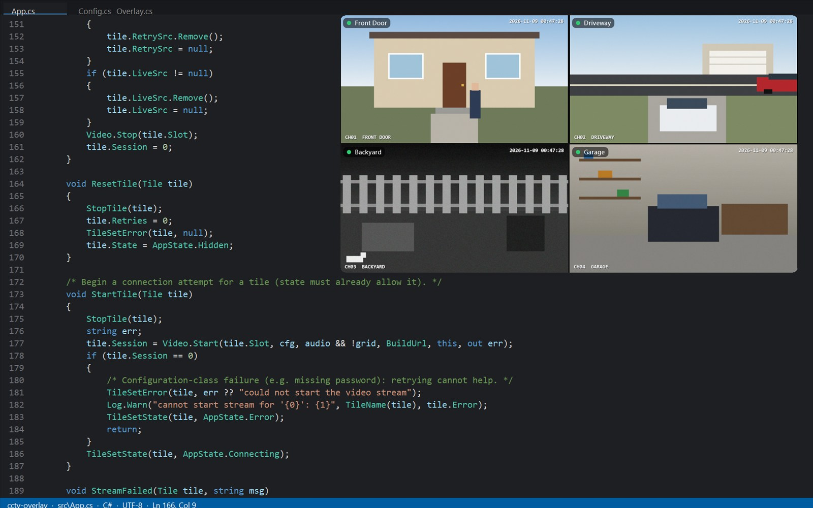
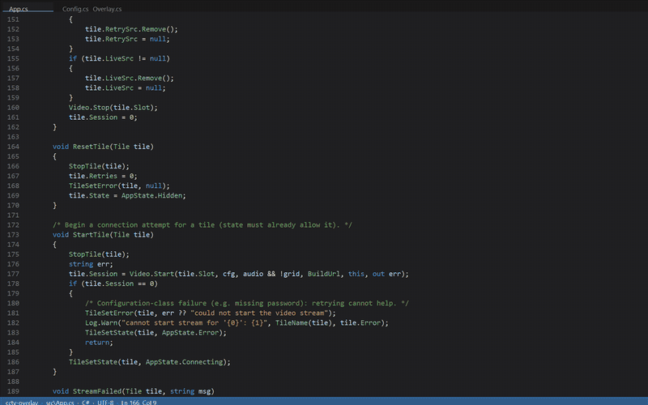
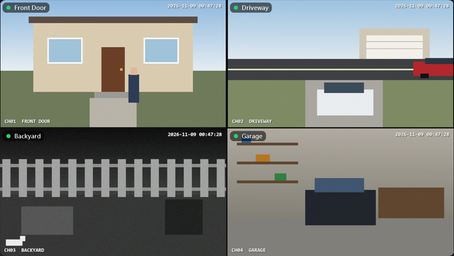
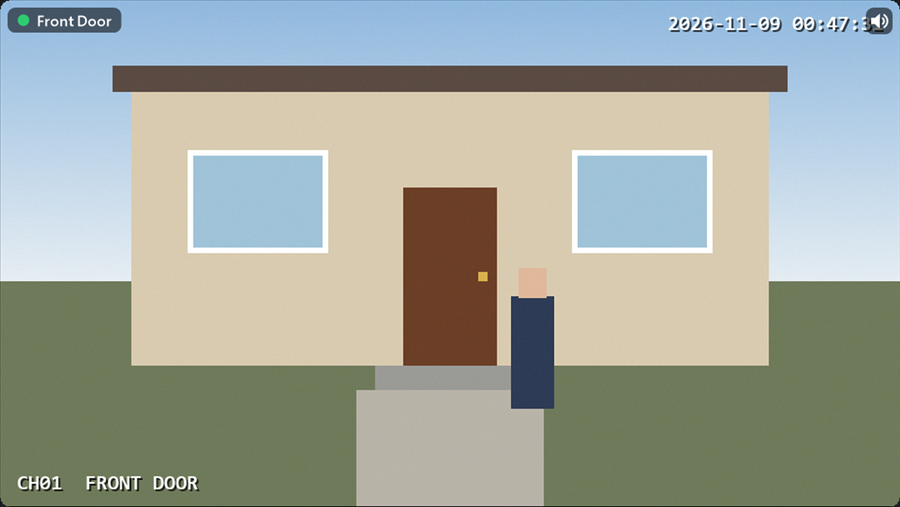
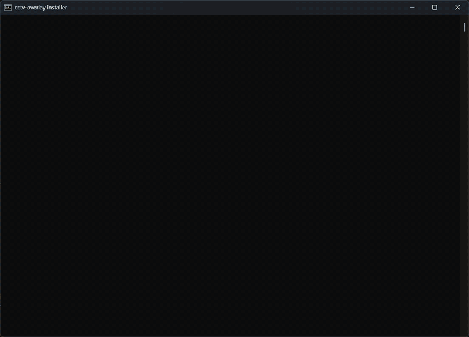

# CCTV Overlay for Windows

Keep an eye on your security cameras while you work or play. **cctv-overlay** shows your CCTV cameras in a
small, always-on-top, click-through window on your Windows desktop: a **4-camera grid** at a glance, then each
camera on its own, with optional **audio**, all driven by a few keys.



<sub>All demo images use synthetic test cameras from [`tools/demo/`](tools/demo/), not real footage.</sub>

This is the Windows edition of [cctv-overlay for Linux](https://github.com/kaibur02/cctv-overlay). It has the
same features, commands, configuration file and behaviour; only the setup is Windows-specific.

## How it works

<p align="center"></p>

| Key (default) | What happens |
|---|---|
| **Ctrl + Num \*** | Show or hide the overlay. It always opens on the **grid** of the first four cameras. |
| **Num \*** | Next view: grid → camera 1 → camera 2 → … → last camera → grid. |
| **Num /** | Previous view (same ring, backwards). |
| **Ctrl + Num −** | Camera **audio** on/off. A small speaker icon shows while sound is on. |

Every key is your choice; the installer asks you to press them. ([High-quality MP4](docs/media/usage.mp4))

| Grid view | Single camera, audio on |
|---|---|
|  |  |

Each tile shows the camera name with a status dot (green live, amber connecting, red error) and, while a camera
is not live, a status line such as `Reconnecting… connection refused`.

## Features

- **Over everything.** A topmost window that re-asserts its place above other always-on-top windows (taskbar,
  other overlays) and above borderless-fullscreen games and videos, on the display and corner you pick.
- **Never in the way.** It never takes keyboard focus and is click-through (mouse input goes to the program
  underneath). It has no taskbar button and no Alt+Tab entry.
- **4-camera grid plus single views.** Each grid tile is its own stream that reconnects on its own, so one offline
  camera doesn't affect the others.
- **Fast and light.** libmpv with Direct3D 11 (D3D11VA) hardware decoding and a low-latency profile. With the
  overlay hidden, **nothing runs**: no player, no network connection, no GPU surface.
- **Works with most camera systems.** Presets for Dahua / Amcrest / Lorex, Hikvision / HiLook / Annke, Reolink and
  Uniview recorders, and for separate IP cameras (including TP-Link Tapo). Any other system can use an RTSP path
  template.
- **Safe with your password.** It lives only in a secrets file that only your Windows account can read. It never
  appears in config files, command lines, logs or status output, and the installer reads it from a hidden prompt.
- **Scriptable.** A small CLI (`cctv-overlay toggle | next | prev | grid | audio | status --json | …`) talks to a
  per-user background process over a private named pipe. There is no network listener.

## Use cases

- **Gaming or watching fullscreen** while keeping an eye on the driveway or front door.
- **Working from home:** see who's at the door without leaving your editor or call.
- **Waiting for a delivery:** keep the front-door camera pinned in a corner.
- **Kids or pets in the backyard:** one key for a quick check, the same key to hide it.
- **Night-time check** from a second monitor, with audio when you need to hear what's going on.

## Requirements

| | Minimum |
|---|---|
| OS | **Windows 10 (1803+) or Windows 11**, 64-bit (x64 or ARM64) |
| Runtime | .NET Framework 4.7.2+ (built into Windows 10 1803+ and Windows 11) |
| Build tools | **None to install**: the installer compiles with the C# compiler that ships with Windows |
| Video engine | libmpv (`libmpv-2.dll`); the installer downloads it (about 30 MB) |
| GPU | Direct3D 11; hardware decoding recommended (the grid decodes four streams) |
| Cameras | An NVR/DVR or IP cameras serving **RTSP** (H.264/H.265) on your network |

`install.cmd --check` tests your machine without changing anything. Details: [`docs/requirements.md`](docs/requirements.md).

## Install

Download or clone this repository, then double-click **`install.cmd`** in it (or run `install.cmd` from a
terminal in that folder). No administrator rights are needed.

<p align="center"></p>

<p align="center"><sub>Recorded in a throwaway profile with a demo password. (<a href="docs/media/install.mp4">High-quality MP4</a>)</sub></p>

The installer:

1. checks the requirements, builds, and installs to `%LOCALAPPDATA%\Programs\cctv-overlay`;
2. downloads libmpv (after asking) from the mpv project's Windows builds and checks its SHA-256;
3. asks **which camera system** you have, **how many cameras**, and a **name** (and channel) for each;
4. asks for the **display**, **size** and **corner**;
5. asks which **keys** to use for show/hide, next, previous and audio: you just press them, and it checks that no
   other program already uses them;
6. asks for the **password** in a hidden prompt and stores it only in `secrets.ini` (readable only by you);
7. starts cctv-overlay in the background at sign-in (so the keys work) and adds it to your `PATH`;
8. opens the overlay once and reports whether each camera is live.

Running it again keeps your existing setup unless you choose to replace it (and offers to change only the keys).
If you type an answer it can't use, it explains why and asks again; when it is started by double-click, its
window stays open at the end so you can read the result.

**Installing with an AI assistant?** Give it [`docs/ai-install.md`](docs/ai-install.md). It asks you the questions
in chat, runs the installer unattended, and leaves only the password for you to type: it runs
`install.cmd --set-password`, which opens a password box on your desktop. Your password never goes through the chat.

Other installer modes: `--check`, `--set-password`, `--test`, `--answers FILE --yes`, `--uninstall`.
Manual build and install: [`docs/install.md`](docs/install.md).

**No cameras yet?** Try it with five synthetic cameras (front door, driveway, a night-vision backyard, garage and
side alley), rendered locally, with nothing to set up and your own setup untouched:

```powershell
powershell -ExecutionPolicy Bypass -File tools\demo\run-demo.ps1 start
powershell -ExecutionPolicy Bypass -File tools\demo\run-demo.ps1 ctl toggle     # also: next, prev, audio, status
powershell -ExecutionPolicy Bypass -File tools\demo\run-demo.ps1 stop
```

## Customisation

Everything lives in `%APPDATA%\cctv-overlay\config.ini`. Edit it and run `cctv-overlay reload`, or re-run
`install.cmd`. Every key is documented in [`docs/configuration.md`](docs/configuration.md).

| What | Where | Example |
|---|---|---|
| Display | `[general] monitor` | `DISPLAY2`, `primary`, or `focused` |
| Size and corner | `[overlay] width`, `height`, `anchor`, `margin_x/y` | `720` × `405`, `top-right` |
| Labels and status dots | `[overlay] show_label`, `show_status` | `false` for a clean picture |
| Main or sub stream | `[stream] subtype`, or per camera | `0` sharp / fast to open, `1` light |
| Decoder | `[stream] hwdec` | `d3d11va`, `auto-safe`, `no` |
| Audio at start | `[stream] audio` | `true` |
| Which cameras are in the grid, and their order | `[grid] cameras` | `driveway, front, backyard, garage` |
| Lighter streams for the grid only | `[grid] subtype` | `1` |
| No grid (plain camera ring) | `[grid] enabled` | `false` |
| Camera order, names, channels | `[camera.<id>]` sections, in file order | `name = Front Door`, `channel = 1` |
| Other camera systems | `[recorder] path` template, or per-camera `host`/`port`/`path` | `/Streaming/Channels/{channel}0{stream}` |
| Keys | `[keys] toggle`, `next`, `prev`, `audio` (or re-run `install.cmd` and just press them) | `Ctrl + Shift + -` |

```ini
[overlay]
width = 720
height = 405
anchor = bottom-right

[keys]
toggle = Ctrl + Num *

[grid]
cameras = driveway, front, backyard, garage

[camera.front]
name = Front Door
channel = 1
```

A `config.ini` from the Linux version works unchanged (add a `[keys]` section for the keys; `hwdec = vaapi` is
treated as `d3d11va`).

## Commands

| Command | Effect |
|---|---|
| `cctv-overlay toggle` | Show or hide (opens on the grid) |
| `cctv-overlay next` / `prev` | Next or previous view: grid → cameras → grid |
| `cctv-overlay grid` | Switch to the grid |
| `cctv-overlay show CAMERA` | Open one camera (name, id or zero-based index) |
| `cctv-overlay audio [on\|off]` | Toggle or set audio |
| `cctv-overlay hide` | Close and release everything |
| `cctv-overlay status [--json]` | State, view, camera, tiles, audio, last error (never credentials) |
| `cctv-overlay list` | Configured cameras |
| `cctv-overlay check` | Validate config and secrets offline (prints no secrets) |
| `cctv-overlay reload` | Re-read config, secrets and keys |
| `cctv-overlay daemon` | Run the daemon in a terminal (it otherwise starts at sign-in or on the first command) |
| `cctv-overlay quit` / `ping` | Stop the daemon / health check |

Exit codes, states and the JSON format: [`docs/behaviour.md`](docs/behaviour.md).

## Security

- The repository contains no credentials, and the examples contain placeholders only.
- The password lives in `secrets.ini` (its permissions allow only your account) or the `CCTV_OVERLAY_PASSWORD`
  environment variable, never on a command line or in `config.ini`. The stream URL with credentials exists only
  while a stream starts, and is wiped after use.
- Logs and errors are redacted. The control pipe accepts only your account (network access denied) and every
  client is checked. There is no network listener.
- RTSP itself is unencrypted. Use a view-only camera account on a trusted network.

Report vulnerabilities privately: see [`SECURITY.md`](SECURITY.md).

## Limitations

- **Exclusive-fullscreen games** (the old "Fullscreen" mode some games still offer) own the display, and no normal
  window can be drawn over them. Use the game's **borderless / windowed fullscreen** mode; the overlay stays on
  top of that.
- All cameras share one user name and password. A camera with different credentials needs a `url` override,
  which puts its password in `config.ini` (discouraged).
- Presets other than Dahua follow the vendors' documented RTSP paths but haven't been tested on real hardware
  yet. Reports are welcome.
- The grid never plays sound. Audio makes mpv sync video to the audio clock, which can add a little latency.
- Global keys are registered by the background process. A key already taken by another program cannot be used
  (the installer and the log say so); pick another one in `[keys]`.
- There is no recording, motion alerts or PTZ control: this is a viewer.

## Documentation

| Document | For |
|---|---|
| [`docs/requirements.md`](docs/requirements.md) | Minimum requirements, camera systems |
| [`docs/install.md`](docs/install.md) | Installer modes, manual build/install, sign-in start, uninstall |
| [`docs/ai-install.md`](docs/ai-install.md) | Step-by-step install for an AI assistant |
| [`docs/configuration.md`](docs/configuration.md) | Every config key, URL templates, grid, audio, keys, secrets |
| [`docs/troubleshooting.md`](docs/troubleshooting.md) | Common errors and logs |
| [`docs/behaviour.md`](docs/behaviour.md) | Commands, states, exit codes, security model |
| [`docs/overlay.md`](docs/overlay.md) | Overlay window, video engine and how the Windows port maps to the Linux design |
| [`CHANGELOG.md`](CHANGELOG.md) | Release notes |

## Development

```bat
powershell -ExecutionPolicy Bypass -File build.ps1          :: real build (build\cctv-overlay.exe, cctv-overlayw.exe)
powershell -ExecutionPolicy Bypass -File build.ps1 check    :: unit + control-pipe tests (stub video, no display)
powershell -ExecutionPolicy Bypass -File build.ps1 smoke    :: real overlay + libmpv with test patterns
powershell -ExecutionPolicy Bypass -File build.ps1 demo     :: demo build with synthetic cameras (tools\demo)
powershell -ExecutionPolicy Bypass -File tools\demo\record-media.ps1   :: re-create docs\media (takes over the screen ~2 min)
```

Written in C# 5 for .NET Framework 4.8 so it builds with the compiler included in Windows; no Visual Studio needed.

```
src/            the program (CLI, daemon, overlay, libmpv engine, named-pipe control, config, logging)
tests/          unit tests and the end-to-end control-pipe test (stub video and overlay)
tools/demo/     synthetic demo cameras, run-demo.ps1, and the media recorder
tools/dev/      VideoSmoke.cs: the real-overlay smoke test
examples/       config, secrets and installer-answers templates
docs/           user and design documentation, media
install.cmd     the installer (runs install.ps1); build.ps1: build, test, demo
```

## Licence

[MIT](LICENSE) © 2026 Kaibur02
